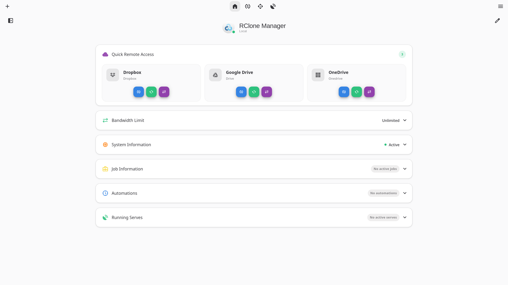
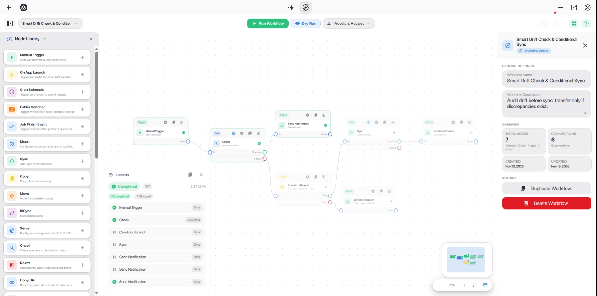
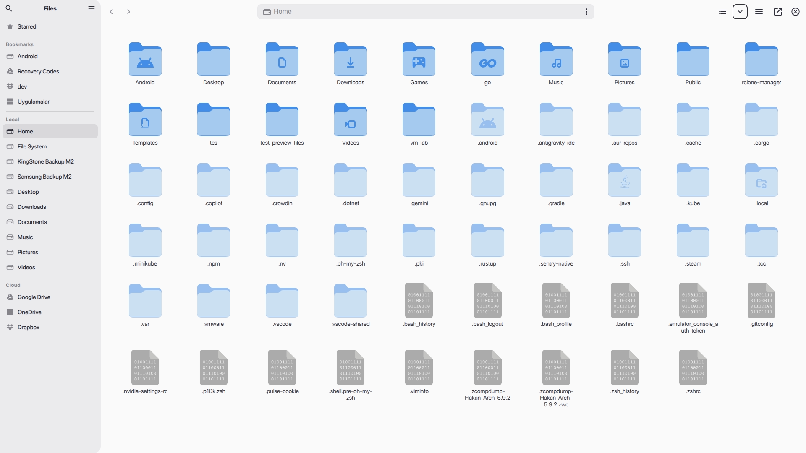

  

<h1 align="center">RClone Manager</h1>

  <a href="README.md">🇺🇸 English</a> •
  <a href="README.tr-TR.md">🇹🇷 Türkçe</a> •
  <a href="README.zh-CN.md">🇨🇳 简体中文</a> •
  <a href="README.zh-TW.md">🇹🇼 繁體中文</a> •
  <a href="README.fr-FR.md">🇫🇷 Français</a> •
  <a href="README.es-ES.md">🇪🇸 Español</a> •
  <a href="README.pt-BR.md">🇧🇷 Português-Brasil</a> •
  <a href="README.ru-RU.md">🇷🇺 Русский</a> •
  <a href="README.ja-JP.md">🇯🇵 日本語</a> •
  <a href="README.sk-SK.md">🇸🇰 Slovenčina</a> •
  <a href="CONTRIBUTING.md#adding-translations">Pomôžte s prekladom</a> •
  <a href="https://crowdin.com/project/rclone-manger">Crowdin</a>

  <b>Výkonné multiplatformové grafické rozhranie na štýlovú a jednoduchú správu vzdialených úložísk Rclone.</b> 
  <i>Postavené na Angular 22 + Tauri · Linux • Windows • macOS • Android (Beta) • podpora ARM</i>

  

  
  
  
  
  
  

---

## Prehľad

**RClone Manager** zjednodušuje správu a synchronizáciu súborov vo vzdialených úložiskách. Ako základ využíva Rclone a ponúka desktopové prostredie so vstavaným správcom súborov (**Nautilus**), v ktorom môžete súbory zo vzdialených úložísk bez námahy prenášať, pripájať a sprístupňovať.

- 📂 **Správca súborov Nautilus:** Prehliadajte, upravujte, presúvajte, kopírujte, premenúvajte a odstraňujte súbory vo vzdialených úložiskách.
- 👁️ **Prehliadač súborov:** Vstavaný náhľad videí, obrázkov, PDF, zvuku a textu.
- ⚡ **Vizuálne pracovné postupy:** Navrhujte a automatizujte viacstupňové cloudové postupy na interaktívnom plátne s uzlami, so spúšťačmi cron, sledovaním priečinkov a okamžitými upozorneniami.
- 🚀 **Rýchle spustenia:** Spúšťajte cloudové operácie a vlastné predvoľby prepínačov CLI jedným kliknutím priamo z mriežky kariet so zobrazením stavu.
- ⚙️ **Pripojenie a servery:** Jednoduché ovládanie pripojení a správa serverov (WebDAV, SFTP, HTTP, FTP).
- 🔄 **Sledovanie úloh:** Sledovanie prenosov v reálnom čase a riadenie šírky pásma.
- 📱 **Android SAF a DocumentsProvider:** Natívny prístup k cloudovým úložiskám v systémových výberoch súborov cez Storage Access Framework a interný most pripojenia VFS bez root.
- 🌐 **Režim bez GUI (headless):** Spúšťajte na VPS/NAS pomocou [RClone Manager Server](backend/server/README.md). Dokumentácia servera a šablóna služby pre Linux sa nachádzajú v `backend/server/`.

---

## Snímky obrazovky

  <picture>
    <source media="(prefers-color-scheme: dark)" srcset="assets/dark-ui.png">
    <source media="(prefers-color-scheme: light)" srcset="assets/desktop-ui.png">
    
  </picture>
   
  Prehľad – rýchle spustenia, pripojenia a prehľad vzdialených úložísk na prvý pohľad

  
   
  Tvorba pracovných postupov – navrhujte a automatizujte viacstupňové cloudové postupy na interaktívnom plátne s uzlami

  
   
  Nautilus – prehliadajte, prenášajte a spravujte súbory vo všetkých vzdialených úložiskách

  <i>📖 Chcete vidieť viac? Všetky funkcie nájdete v <b><a href="https://hakanismail.info/zarestia/rclone-manager/docs/gallery">galérii na wiki</a></b>.</i>

---

## Inštalácia a stiahnutie

Nainštalujte RClone Manager pomocou preferovaného správcu balíkov alebo si stiahnite samostatné binárne súbory priamo zo stránky [Releases](https://github.com/Zarestia-Dev/rclone-manager/releases).

### Linux

| Zdroj                 | Verzia                                                                                                                                                                                  | Príkaz na inštaláciu / stiahnutie                                                                                            |
| :-------------------- | :-------------------------------------------------------------------------------------------------------------------------------------------------------------------------------------- | :--------------------------------------------------------------------------------------------------------------------------- |
| **AUR**               |                                    | `yay -S rclone-manager`                                                                                                      |
| **AUR (Git)**         |                            | `yay -S rclone-manager-git`                                                                                                  |
| **Flathub**           |      | `flatpak install io.github.zarestia_dev.rclone-manager`                                                                      |
| **Priame stiahnutie** |  | [Najnovšie vydania (.deb, .rpm, .AppImage, prenosný tar.gz)](https://github.com/Zarestia-Dev/rclone-manager/releases/latest) |

> 📚 **Návod:** [Wiki: Inštalácia – Linux](https://hakanismail.info/zarestia/rclone-manager/docs/installation-linux) (riešenie problémov s Flatpakom, snapshotmi atď.)

### macOS

| Zdroj                 | Verzia                                                                                                                                                                                                         | Príkaz na inštaláciu / stiahnutie                                                                          |
| :-------------------- | :------------------------------------------------------------------------------------------------------------------------------------------------------------------------------------------------------------- | :--------------------------------------------------------------------------------------------------------- |
| **Homebrew**          |  | `brew tap Zarestia-Dev/zarestia && brew trust zarestia-dev/zarestia && brew install --cask rclone-manager` |
| **Priame stiahnutie** |                         | [Inštalátor DMG](https://github.com/Zarestia-Dev/rclone-manager/releases/latest)                           |

> 📚 **Návod:** [Wiki: Inštalácia – macOS](https://hakanismail.info/zarestia/rclone-manager/docs/installation-macos) (riešenia pre macFUSE a Gatekeeper)

### Windows

| Zdroj                 | Verzia                                                                                                                                                                                                            | Príkaz na inštaláciu / stiahnutie                                                           |
| :-------------------- | :---------------------------------------------------------------------------------------------------------------------------------------------------------------------------------------------------------------- | :------------------------------------------------------------------------------------------ |
| **Winget**            |  | `winget install RClone-Manager.rclone-manager`                                              |
| **Chocolatey**        |                                               | `choco install rclone-manager`                                                              |
| **Scoop**             |                    | `scoop bucket add extras && scoop install rclone-manager`                                   |
| **Priame stiahnutie** |                            | [Inštalátor / prenosný EXE](https://github.com/Zarestia-Dev/rclone-manager/releases/latest) |

> 📚 **Návod:** [Wiki: Inštalácia – Windows](https://hakanismail.info/zarestia/rclone-manager/docs/installation-windows) (požiadavky WinFsp na pripájanie a SmartScreen)

### Android (Beta)

| Zdroj                 | Verzia                                                                                                                                                                                  | Príkaz na inštaláciu / stiahnutie                                                                                      |
| :-------------------- | :-------------------------------------------------------------------------------------------------------------------------------------------------------------------------------------- | :--------------------------------------------------------------------------------------------------------------------- |
| **Priame stiahnutie** |  | [Stiahnutie APK (arm64-v8a, armeabi-v7a, x86_64, x86)](https://github.com/Zarestia-Dev/rclone-manager/releases/latest) |

> 📱 **Storage Access Framework (SAF):** Obsahuje natívnu integráciu `DocumentsProvider` (`RcloneDocumentsProvider`) a interný most pripojenia VFS, ktoré sprístupňujú pripojené cloudové úložiská priamo systémovým výberom súborov v Androide a externým aplikáciám bez potreby root alebo `/dev/fuse`.
>
> 📚 **Návod:** [Wiki: Podpora Androidu (Beta)](https://hakanismail.info/zarestia/rclone-manager/docs/configuration-android) (podrobnosti o jadre Go / librclone, poskytovateľ SAF a nastavenie)

> 🛠️ **Systémové požiadavky:** Pripájanie jednotiek vyžaduje WinFsp (Windows), macFUSE (macOS) alebo FUSE3 (Linux). Samotný Rclone sa v prípade potreby stiahne automaticky. Pozri [Wiki: Systémové požiadavky](https://hakanismail.info/zarestia/rclone-manager/docs/Installation#%EF%B8%8F-dependencies).

---

## Vývoj a podpora

- **Zostavenie zo zdrojového kódu:** Pozri [návod na zostavenie](https://hakanismail.info/zarestia/rclone-manager/docs/building).
- **Kvalita kódu:** Pravidlá štýlu nájdete v [LINTING.md](LINTING.md).
- **Riešenie problémov:** Navštívte [wiki o riešení problémov](https://hakanismail.info/zarestia/rclone-manager/docs/troubleshooting) alebo si prečítajte [ISSUES.md](ISSUES.md) s poznámkami pre jednotlivé platformy.

---

## Prispievanie

Vítame príspevky všetkých druhov!

- 🌍 **Preklady:** Pridajte sa k [projektu na Crowdin](https://crowdin.com/project/rclone-manger) alebo si prečítajte [návod na preklad](CONTRIBUTING.md#adding-translations).
- 🐛 **Chyby a funkcie:** Založte [issue](https://github.com/Zarestia-Dev/rclone-manager/issues) alebo si pozrite [tabuľu projektu](https://github.com/users/Zarestia-Dev/projects/2).
- 🔧 **Zmeny kódu:** Pred odoslaním pull requestu si prečítajte [CONTRIBUTING.md](CONTRIBUTING.md).
- 👥 **Prispievatelia:** V [CONTRIBUTORS.md](CONTRIBUTORS.md) nájdete všetkých, ktorí pomohli vytvoriť RClone Manager.

---

## Licencia a podpora

- **Licencia:** Šírené pod licenciou [GNU GPLv3](LICENSE) – môžete ho voľne používať, upravovať a šíriť.
- **Podpora:** Ak sa vám projekt páči, zvážte udelenie ⭐ na GitHube!

  Vytvoril s ❤️ tím Zarestia Dev 
  Poháňané Rclone | Postavené na Angular a Tauri

